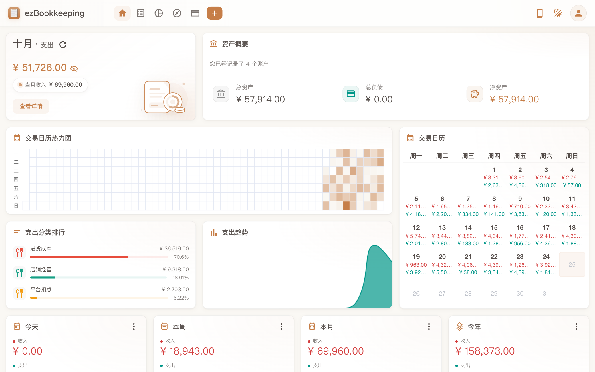

# 小店记账（ezBookkeeping）

> 篝火出品 · 收录于篝火 App 应用区 · 基于开源项目 [mayswind/ezbookkeeping](https://github.com/mayswind/ezbookkeeping)（MIT）

给小店用的自托管记账网站：记进货、货款、平台扣点等收支，搜索筛选账单，看图表报表。数据存在你自己的服务器上，手机和电脑用浏览器都能打开。

<p align="center"></p>

截图是本机真实运行的界面，里面的账目是虚构的示例数据。

## 部署（需要一台装好 Docker 的服务器或电脑）

```bash
mkdir shop-bookkeeping && cd shop-bookkeeping
# 下载 Releases 里的 docker-compose.yml 和 .env.example
cp .env.example .env     # 然后编辑 .env，至少把 EBK_SECURITY_SECRET_KEY 改成你自己的一长串随机字符
docker compose up -d
```

然后浏览器打开 `http://服务器地址:8080`，先注册第一个账号。

- 镜像：`ghcr.io/campfire-code/shop-bookkeeping:latest`，支持 x86 与 ARM。
- 数据都在 Docker 卷 `ebk-data`（数据库）、`ebk-storage`（附件）、`ebk-log`（日志）里，**备份时备份这些卷**。不要用 `docker compose down -v`，那会删除全部账本。
- 上游要求首次运行前设置 `secret_key`（用于登录签名），之后不要再改。
- 自己注册好账号后，把 `.env` 里的 `EBK_USER_ENABLE_REGISTER` 改成 `false` 再 `docker compose up -d`，避免陌生人在你的服务器上注册。
- 如果要放到公网，请自己加 HTTPS 反向代理，不要裸露 8080 端口。
- 配置项也可以在 `.env` 里用 `EBK_<段名>_<项名>` 的形式覆盖，规则来自上游源码，可用项见上游 `conf/ezbookkeeping.ini`。

## 界面语言

界面语言跟随浏览器语言：浏览器语言是简体中文时，打开就是简体中文，不用设置。浏览器是别的语言、打开后是英文时，两处任选其一切换：

- 登录页右下角的语言名称（例如 English）点开，选「中文 (简体)」。
- 登录后点右上角头像进入「用户设置」，在「用户信息」页的「语言 / Language」一栏选「中文 (简体)」，保存。

简体中文界面里的应用名（页头、登录页、浏览器标签页标题、手机添加到主屏幕的名称、导出文件名）已改为「小店记账」；登录页底部的链接文字也改为「小店记账」（仍指向上游仓库）；「关于」里保留上游项目名 ezBookkeeping 和版本号，作为原作者致谢。

## 小店常用收支分类（建议）

本仓库没有改功能代码（只改了简体中文语言包和页面标题里的应用名），下面只是推荐清单，请自己在软件里添加。

| 类型 | 一级分类 | 可细分的二级分类 |
|---|---|---|
| 支出 | 进货成本 | 货款、样品 |
| 支出 | 平台扣点 | 佣金、技术服务费、支付手续费 |
| 支出 | 物流运费 | 快递费、退货运费 |
| 支出 | 推广费用 | 平台推广、达人佣金 |
| 支出 | 店铺经营 | 房租水电、包装耗材、员工工资 |
| 收入 | 货款收入 | 线上店铺、线下门店 |
| 收入 | 其他收入 | 平台补贴、赔付 |
| 支出 | 退款 | 买家退款（也可以用收入的负向冲账，按自己习惯） |

添加方式：

- **手动添加**：进入"交易分类"页，新建一级分类，再在其下新建二级分类。上游界面里另有"添加默认分类"，是上游自带的通用预设，不是小店专用。
- **导入时自动创建**：上游支持导入账单（CSV、Excel、OFX、QFX、QIF、IIF、Camt.052/053、MT940、GnuCash、Firefly III、Beancount 等；国内的支付宝、随手记类账单格式也有对应导入器，具体以导入窗口里列出的类型为准）。在"交易"页点"导入交易"，选择文件类型和文件，可勾选"创建不存在的支出分类 / 收入分类 / 转账分类"，导入文件里出现的新分类就会自动建出来。想一次建好上表分类，可以准备一个只有分类名的小 CSV，用自定义列映射导入后再删掉这几笔测试交易。
- 上游没有"只导入分类清单"的功能入口，以上做法是借用交易导入，用前请先在测试账号试一遍。

## 验收用例

| 操作 | 应得到 |
|---|---|
| `docker compose up -d` 后访问 `http://服务器地址:8080/` | 返回 200，看到登录 / 注册页 |
| 注册账号，进入"交易分类"，新建"进货成本"及二级分类 | 分类出现在列表中 |
| 记一笔支出，分类选"进货成本" | 交易列表和统计图里出现这笔支出 |
| `docker compose restart` 后重新登录 | 之前的账目还在（数据卷生效） |

## 和上游的区别

- 仅新增中文说明、`campfire/docker-compose.yml`、`campfire/.env.example` 和篝火发布流程（`tool.json`、`.github/workflows/release.yml`）。
- 新增 `docker/Dockerfile.campfire`：与上游 Dockerfile 一致，只是构建时跳过 lint 和单元测试，减少内存占用；程序代码不变。
- 移除了上游的构建发布工作流，这些依赖上游的密钥。

## 归属与许可证

本仓库由**篝火**整理发布，是篝火 App 应用区收录的开源工具之一。软件全部功能与版权归 [mayswind/ezbookkeeping](https://github.com/mayswind/ezbookkeeping) 原作者所有，按 MIT 许可证再分发。全部工具目录见 [toolkit-hub](https://github.com/campfire-code/toolkit-hub)。

---

以下为上游原始说明：

# ezBookkeeping
[](https://github.com/mayswind/ezbookkeeping/blob/master/LICENSE)
[](https://github.com/mayswind/ezbookkeeping/releases)
[](https://github.com/mayswind/ezbookkeeping/actions)
[](https://hub.docker.com/r/mayswind/ezbookkeeping)
[](https://hub.docker.com/r/mayswind/ezbookkeeping)
[](https://deepwiki.com/mayswind/ezbookkeeping)

[](https://hellogithub.com/en/repository/mayswind/ezbookkeeping)
[](https://trendshift.io/repositories/12917)

## Introduction
ezBookkeeping is an open source, powerful, self-hosted personal finance app that is easy to use. It helps you record daily transactions, import data from various sources, and quickly search and filter your bills. You can analyze historical data using built-in charts or perform custom queries with your own chart dimensions to better understand spending patterns and financial trends. ezBookkeeping is easy to deploy, and you can start it with just one single Docker command. Designed to be resource-efficient, it runs smoothly on devices such as home servers, NAS and Raspberry Pi.

ezBookkeeping offers tailored interfaces for mobile and desktop devices. With PWA (Progressive Web Apps) support, you can [add it to your mobile home screen](https://raw.githubusercontent.com/wiki/mayswind/ezbookkeeping/img/mobile/add_to_home_screen.gif) and use it like a native app.

Live Demo: [https://ezbookkeeping-demo.mayswind.net](https://ezbookkeeping-demo.mayswind.net)

## Features
- **Open Source & Self-Hosted**
    - Built for privacy and control
- **Lightweight & Fast**
    - Minimal resource usage, suitable for home servers, NAS and Raspberry Pi
- **Easy Installation**
    - Docker support
    - SQLite, MySQL and PostgreSQL support
    - Cross-platform (Windows, macOS, Linux)
    - Works on x86, amd64, ARM architectures
- **User-Friendly Interface**
    - UI optimized for both mobile and desktop
    - PWA support for native-like mobile experience
    - Customizable overview layouts
    - Dark mode
- **AI-Powered Features**
    - Text and receipt image recognition
    - AI custom chart generation
    - MCP (Model Context Protocol) for AI integration
    - Agent Skill and API command-line script tools for AI integration
- **Powerful Bookkeeping**
    - Two-level accounts and categories
    - Image attachments for transactions
    - Location tracking with maps
    - Scheduled transactions
    - Advanced filtering, search, visualization and analysis
- **Localization & Internationalization**
    - Multi-language and multi-currency support
    - Multiple exchange rate sources with automatic updates
    - Multi-timezone support
    - Custom formats for dates, numbers and currencies
- **Security**
    - Two-factor authentication (2FA)
    - OIDC external authentication
    - Login rate limiting
    - Application lock (PIN code / WebAuthn)
- **Data Import & Export**
    - Import CSV, Excel, OFX, QFX, QIF, IIF, Camt.052, Camt.053, MT940, GnuCash, Firefly III, Beancount and more
    - Custom column mapping, rules and scripts for CSV / Excel imports

For a full list of features, visit the [Full Feature List](https://ezbookkeeping.mayswind.net/features/).

## Screenshots
### Desktop Version
[](https://raw.githubusercontent.com/wiki/mayswind/ezbookkeeping/img/desktop/en.png)

### Mobile Version
[](https://raw.githubusercontent.com/wiki/mayswind/ezbookkeeping/img/mobile/en.png)

## Installation
### Run with Docker
Visit [Docker Hub](https://hub.docker.com/r/mayswind/ezbookkeeping) to see all images and tags.

**Latest Release:**

    $ docker run -p8080:8080 mayswind/ezbookkeeping

**Latest Daily Build:**

    $ docker run -p8080:8080 mayswind/ezbookkeeping:latest-snapshot

For production use of ezBookkeeping, you need to mount a persistent volume when starting the container to prevent data loss. For more information, see [documentation](https://ezbookkeeping.mayswind.net/installation/installation-docker).

### Install from Binary
Download the latest release: [https://github.com/mayswind/ezbookkeeping/releases](https://github.com/mayswind/ezbookkeeping/releases)

**Linux / macOS**

    $ ./ezbookkeeping server run

**Windows**

    > .\ezbookkeeping.exe server run

By default, ezBookkeeping listens on port 8080. You can then visit `http://{YOUR_HOST_ADDRESS}:8080/` .

### Build from Source
Make sure you have [Golang](https://golang.org/), [GCC](https://gcc.gnu.org/), [Node.js](https://nodejs.org/) and [NPM](https://www.npmjs.com/) installed. Then download the source code, and follow these steps:

**Linux / macOS**

    $ ./build.sh package -o ezbookkeeping.tar.gz

All the files will be packaged in `ezbookkeeping.tar.gz`.

**Windows**

    > .\build.bat package -o ezbookkeeping.zip

or

    PS > .\build.ps1 package -Output ezbookkeeping.zip

All the files will be packaged in `ezbookkeeping.zip`.

You can also build a Docker image. Make sure you have [Docker](https://www.docker.com/) installed, then follow these steps:

**Linux**

    $ ./build.sh docker

## Contributing
We welcome contributions of all kinds.

If you find a bug, please [submit an issue](https://github.com/mayswind/ezbookkeeping/issues) on GitHub.

If you would like to contribute code, you can fork the repository and open a pull request.

Improvements to documentation, feature suggestions, and other forms of feedback are also appreciated.

You can view existing contributors on the [Contributor Graph](https://github.com/mayswind/ezbookkeeping/graphs/contributors).

## Translating
Help make ezBookkeeping accessible to users around the world. We welcome help to improve existing translations or add new ones. If you would like to contribute a translation, please refer to the [translation guide](https://ezbookkeeping.mayswind.net/translating).

Currently available translations:

| Tag | Language | Progress | Contributors |
| --- | --- | --- | --- |
| de | Deutsch | [](https://github.com/mayswind/ezBookkeeping-i18n-badge/blob/main/untranslated/de.json) | [@chrgm](https://github.com/chrgm), [@1270o1](https://github.com/1270o1), [@martinschilliger](https://github.com/martinschilliger), [@marcelweikum](https://github.com/marcelweikum) |
| el | Ελληνικά | [](https://github.com/mayswind/ezBookkeeping-i18n-badge/blob/main/untranslated/el.json) | [@konet-gr](https://github.com/konet-gr) |
| en | English | [](https://github.com/mayswind/ezBookkeeping-i18n-badge/blob/main/untranslated/en.json) | / |
| es | Español | [](https://github.com/mayswind/ezBookkeeping-i18n-badge/blob/main/untranslated/es.json) | [@Miguelonlonlon](https://github.com/Miguelonlonlon), [@abrugues](https://github.com/abrugues), [@AndresTeller](https://github.com/AndresTeller), [@diegofercri](https://github.com/diegofercri) |
| fr | Français | [](https://github.com/mayswind/ezBookkeeping-i18n-badge/blob/main/untranslated/fr.json) | [@brieucdlf](https://github.com/brieucdlf) |
| it | Italiano | [](https://github.com/mayswind/ezBookkeeping-i18n-badge/blob/main/untranslated/it.json) | [@waron97](https://github.com/waron97), [@albanobattistella](https://github.com/albanobattistella) |
| ja | 日本語 | [](https://github.com/mayswind/ezBookkeeping-i18n-badge/blob/main/untranslated/ja.json) | [@tkymmm](https://github.com/tkymmm), [@Mink16](https://github.com/Mink16), [@x0x0b](https://github.com/x0x0b) |
| kn | ಕನ್ನಡ | [](https://github.com/mayswind/ezBookkeeping-i18n-badge/blob/main/untranslated/kn.json) | [@Darshanbm05](https://github.com/Darshanbm05) |
| ko | 한국어 | [](https://github.com/mayswind/ezBookkeeping-i18n-badge/blob/main/untranslated/ko.json) | [@overworks](https://github.com/overworks) |
| nl | Nederlands | [](https://github.com/mayswind/ezBookkeeping-i18n-badge/blob/main/untranslated/nl.json) | [@automagics](https://github.com/automagics) |
| pl | Polski | [](https://github.com/mayswind/ezBookkeeping-i18n-badge/blob/main/untranslated/pl.json) | [@mnowok](https://github.com/mnowok) |
| pt-BR | Português (Brasil) | [](https://github.com/mayswind/ezBookkeeping-i18n-badge/blob/main/untranslated/pt-BR.json) | [@thecodergus](https://github.com/thecodergus), [@balaios](https://github.com/balaios) |
| ro | Română | [](https://github.com/mayswind/ezBookkeeping-i18n-badge/blob/main/untranslated/ro.json) | [@gg64nou](https://github.com/gg64nou) |
| ru | Русский | [](https://github.com/mayswind/ezBookkeeping-i18n-badge/blob/main/untranslated/ru.json) | [@artegoser](https://github.com/artegoser), [@dshemin](https://github.com/dshemin), [@zhugaru](https://github.com/zhugaru) |
| sl | Slovenščina | [](https://github.com/mayswind/ezBookkeeping-i18n-badge/blob/main/untranslated/sl.json) | [@thehijacker](https://github.com/thehijacker) |
| ta | தமிழ் | [](https://github.com/mayswind/ezBookkeeping-i18n-badge/blob/main/untranslated/ta.json) | [@hhharsha36](https://github.com/hhharsha36) |
| th | ไทย | [](https://github.com/mayswind/ezBookkeeping-i18n-badge/blob/main/untranslated/th.json) | [@natthavat28](https://github.com/natthavat28) |
| tr | Türkçe | [](https://github.com/mayswind/ezBookkeeping-i18n-badge/blob/main/untranslated/tr.json) | [@aydnykn](https://github.com/aydnykn), [@snizamaddinov](https://github.com/snizamaddinov) |
| uk | Українська | [](https://github.com/mayswind/ezBookkeeping-i18n-badge/blob/main/untranslated/uk.json) | [@nktlitvinenko](https://github.com/nktlitvinenko), [@grid-pilot](https://github.com/grid-pilot), [@infinit1ve](https://github.com/infinit1ve) |
| vi | Tiếng Việt | [](https://github.com/mayswind/ezBookkeeping-i18n-badge/blob/main/untranslated/vi.json) | [@f97](https://github.com/f97) |
| zh-Hans | 中文 (简体) | [](https://github.com/mayswind/ezBookkeeping-i18n-badge/blob/main/untranslated/zh-Hans.json) | / |
| zh-Hant | 中文 (繁體) | [](https://github.com/mayswind/ezBookkeeping-i18n-badge/blob/main/untranslated/zh-Hant.json) | / |

## Documentation
1. [English](https://ezbookkeeping.mayswind.net)
1. [中文 (简体)](https://ezbookkeeping.mayswind.net/zh_Hans)

## License
[MIT](https://github.com/mayswind/ezbookkeeping/blob/master/LICENSE)
